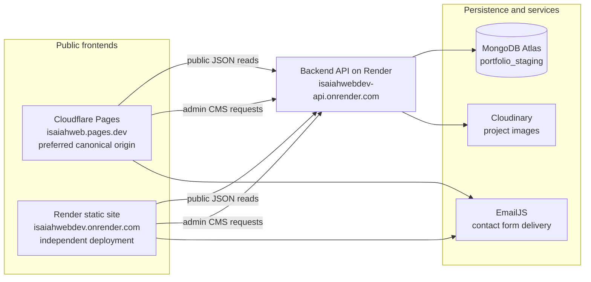

# Isaiah Yemi Adelowo — Portfolio

A personal developer portfolio for **Isaiah Yemi Adelowo**, built as a static, responsive frontend with a separately deployed Node.js API and a private content-management system.

- **Primary portfolio:** [isaiahweb.pages.dev](https://isaiahweb.pages.dev)
- **Alternative frontend:** [isaiahwebdev.onrender.com](https://isaiahwebdev.onrender.com)
- **Repository:** [KAOS-CODM/isaiahwebdev](https://github.com/KAOS-CODM/isaiahwebdev)

The two frontend URLs are independent deployments of the same static site. Neither is the backend, and neither redirects to the other. `https://isaiahweb.pages.dev` is the preferred canonical origin used in SEO metadata.

## Table of contents

- [Overview](#overview)
- [Features](#features)
- [Technology stack](#technology-stack)
- [Architecture](#architecture)
- [Repository structure](#repository-structure)
- [Local development](#local-development)
- [Administrative CMS](#administrative-cms)
- [Image uploads](#image-uploads)
- [SEO and discoverability](#seo-and-discoverability)
- [Testing and quality assurance](#testing-and-quality-assurance)
- [About the developer](#about-the-developer)
- [Contact](#contact)
- [License](#license)

## Overview

This repository contains the portfolio's public pages, shared frontend modules, styling, content fixtures, tests, build tooling, and the CMS API. The public site presents projects, skills, credentials, a resume, and contact information. Content such as projects and certificates is managed through a private admin interface backed by MongoDB rather than being maintained directly in HTML.

The visual language is a near-black charcoal base with amber and gold accents (`#f5b942` and `#fde68a`). GitHub Markdown does not support project CSS, so this README uses structure, tables, and restrained emoji rather than embedded theme styling.

At a glance:

| Component | Location | Role |
| --- | --- | --- |
| Primary frontend | <https://isaiahweb.pages.dev> | Preferred canonical portfolio deployment on Cloudflare Pages |
| Alternative frontend | <https://isaiahwebdev.onrender.com> | Independently accessible static deployment on Render |
| Backend API | <https://isaiahwebdev-api.onrender.com> | Separately deployed JSON API and private admin surface |
| Database | MongoDB Atlas (`portfolio_staging`) | Persists projects, certificates, and the administrator account |
| Image storage | Cloudinary | Stores project images uploaded through the CMS |
| Contact delivery | EmailJS | Sends messages from the public contact form |

## Features

Confirmed features in the current source:

- 🏠 **Homepage** with a personal introduction, selected work, and an image lightbox.
- 👤 **About page** describing background, interests, and technical focus.
- 🧩 **Projects listing** with crawlable initial markup, client-side hydration, project images, and technologies.
- 📄 **Project detail pages** through both the static `/project?slug=<slug>` shell and server-rendered `/projects/<slug>` responses from the API.
- 🎓 **Certificates page** that renders published credentials from the CMS API with issuer, date, verification, and validity information.
- 📑 **Resume page** with downloadable PDF documents under `docs/`.
- ✉️ **Contact page** with client-side validation and EmailJS delivery.
- 🔐 **Administrative CMS** for signed-in content management.
- ✍️ **Project management**: create, edit, publish, unpublish, preview, reorder, feature, and delete projects.
- 🏅 **Certificate management**: create, edit, publish, unpublish, preview, reorder, and delete certificates.
- 🖼️ **Project image management**: Cloudinary uploads plus a manual image-URL fallback.
- 📱 **Responsive interface** built with CSS and Tailwind-generated styles.
- 🔎 **SEO implementation**: canonical URLs, Open Graph, Twitter cards, JSON-LD, breadcrumbs, `robots.txt`, and a styled XML sitemap.

## Technology stack

| Area | Technology | Actual role in this project |
| --- | --- | --- |
| Frontend | HTML5 | Semantic pages for home, about, projects, project detail, certificates, resume, contact, and admin |
| Frontend | CSS3 | Responsive layouts, dark visual identity, component styles, and sitemap presentation |
| Frontend | JavaScript (ES modules and classic scripts) | API loading, dynamic rendering, validation, reveal effects, navigation, and admin UI |
| Frontend build | Tailwind CSS 4 | Utility styles generated from `tailwind-workspace/input.css` into `css/styles.css` via the CLI |
| Frontend assets | Font Awesome and Google Fonts | Local Font Awesome icons and externally loaded Exo 2 / Orbitron fonts |
| Backend | Node.js (>= 20.6) | Native `http` server; the API does **not** use Express |
| Backend | Node.js `crypto` | Password hashing, HMAC token signing, and constant-time verification |
| Database | MongoDB driver / MongoDB Atlas | Persists projects, certificates, and the single administrator record in `portfolio_staging` |
| Image storage | Cloudinary | Server-side upload and deletion of project images |
| Contact delivery | EmailJS | Browser-side contact form delivery using public client identifiers |
| Tooling | npm and Node test runner | Dependency scripts, dependency install, and automated tests |
| Version control | Git and GitHub | Source history, collaboration, and issue/security alerts |
| Hosting | Cloudflare Pages | Primary static frontend deployment |
| Hosting | Render | Alternative static frontend and separate backend API deployments |

> React, Firebase, and Express.js are **not** part of the implemented production stack. Older README text that claimed otherwise has been removed.

## Architecture



### Public frontend

The static frontend owns page structure, styling, navigation, and client-side rendering. It loads published projects from `/api/content/projects` and published certificates from `/api/content/certificates`. `js/api-base.js` sets the production API origin on non-local hosts, while `js/api-config.js` resolves `http://localhost:8080` for local development and falls back to `data/projects.json` when the projects API is unusable. The frontend does not contain backend credentials.

### Alternative frontend deployment

`https://isaiahwebdev.onrender.com` serves the same static application independently. It is not a redirect to the canonical domain and is not the API. SEO tags still prefer `https://isaiahweb.pages.dev` so that both deployments point to one canonical identity.

### Backend API

The backend is a standalone Node.js service using the built-in HTTP server. It provides:

- Public read-only project and certificate JSON endpoints.
- Server-rendered project detail HTML at `/projects/<slug>`.
- A private `/api/admin` surface for projects, certificates, media, and sessions.
- A `/health` endpoint.
- Strict CORS origin validation and a non-production allowlisted static-file server for unified local development.

In production the API remains API-only; it does not host the portfolio frontend.

### Database and external services

MongoDB stores the CMS content and the single administrator account. Cloudinary is used only for project images uploaded through the admin interface. EmailJS handles contact-form delivery from the browser. The committed JSON files under `data/` are development/content fixtures and a projects fallback, not the production source of truth for CMS content.

## Repository structure

```text
isaiahwebdev/
├── about.html
├── admin.html
├── certificates.html
├── contact.html
├── index.html
├── project.html
├── projects.html
├── resume.html
├── README.md
├── LICENSE.md
├── QUICK_REFERENCE.md
├── SEO_VALIDATION_CHECKLIST.md
├── WORKFLOW_BRAIN.md
├── robots.txt
├── serve_local.py
├── sitemap.xml
├── assets/                      # Font Awesome and icon assets
├── backend/
│   ├── .env.example
│   ├── package.json
│   ├── package-lock.json
│   ├── scripts/
│   │   └── migrate-legacy-projects.js
│   ├── src/
│   │   ├── index.js             # HTTP server and route dispatch
│   │   ├── lib/                 # DB, auth, schemas, stores, media, rendering
│   │   ├── middleware/          # CORS validation
│   │   └── routes/              # public, admin, health, static, project pages
│   └── test/                    # Node test-runner suites
├── css/
│   ├── styles.css               # Generated Tailwind output
│   ├── style.css
│   ├── common.css
│   ├── certificates-public.css
│   ├── sitemap.css
│   └── page-specific stylesheets
├── data/
│   ├── projects.json            # Fallback project fixture
│   ├── skills.json
│   ├── certificates.json
│   ├── footer.json
│   └── project-images/
├── docs/
│   ├── static-project-generation.md
│   └── resume PDFs
├── icon/                        # Favicons
├── images/                      # Profile and project imagery
├── js/
│   ├── api-base.js              # Production API origin override
│   ├── api-config.js            # API-first loader and local fallback
│   ├── admin.js                 # Admin UI
│   ├── admin-api.js             # Cookie-authenticated API client
│   ├── certificates.js          # Public certificates renderer
│   ├── project-detail-page.js   # Static project shell renderer and metadata
│   ├── projects-page.js         # Projects listing behaviour
│   ├── projects-schema.js       # Shared normalization and URL rules
│   └── shared UI modules
├── logo/
├── scripts/
│   └── generate-static-projects.mjs
├── tailwind-workspace/
│   ├── input.css
│   ├── package.json
│   └── package-lock.json
└── tests/
    ├── fixtures/
    └── *.test.mjs               # Frontend and generator tests
```

`node_modules/`, caches, temporary outputs, and generated browser artifacts are intentionally omitted.

## Local development

### Prerequisites

- Git.
- Node.js **20.6 or newer** for the backend (`backend/package.json` declares this engine).
- npm.
- A MongoDB Atlas connection string for backend and CMS work.
- Python 3 for the included static development server.
- A modern browser with ES module support.
- Tailwind CLI dependencies installed in `tailwind-workspace` only when rebuilding CSS.

### Clone the repository

```bash
git clone https://github.com/KAOS-CODM/isaiahwebdev.git
cd isaiahwebdev
```

### Frontend setup

Serve the static site with the included Python server:

```bash
python3 serve_local.py
# http://127.0.0.1:3000
```

`serve_local.py` supports extensionless routes such as `/about`, `/projects`, `/certificates`, `/resume`, and `/contact`. It binds to `127.0.0.1:3000` and is intended for local development.

Alternatively, after configuring and starting the backend in development mode, the API itself serves an allowlisted set of public frontend files at <http://localhost:8080>. This unified server is disabled when `NODE_ENV=production`.

No frontend `.env` file is required. API origin behaviour is:

- Localhost / `127.0.0.1`: `js/api-config.js` uses `http://localhost:8080`.
- Deployed non-local hosts: `js/api-base.js` sets `window.PORTFOLIO_API_BASE` to `https://isaiahwebdev-api.onrender.com`.
- If the projects API is unavailable or unusable, the homepage and listing fall back to `data/projects.json`. Certificates are rendered from the API and do not duplicate static content.

To rebuild Tailwind CSS:

```bash
cd tailwind-workspace
npm install
npm run build
```

`npm run build` writes the minified output to `../css/styles.css`, so review that tracked file before committing. `npm run watch` and `npm run watch:min` are available for iterative work.

### Backend setup

```bash
cd backend
npm install
cp .env.example .env
# Edit backend/.env with your local values.
npm run dev
```

Useful backend scripts:

| Command | Purpose |
| --- | --- |
| `npm run dev` | Start with `--watch` and load `backend/.env`; default address is <http://localhost:8080> |
| `npm start` | Start without file watching |
| `npm test` | Run the backend Node test suites |

The server uses `PORT` when provided and otherwise defaults to `8080`. It requires `MONGODB_URI` to connect to the `portfolio_staging` database. In non-production, missing `CORS_ORIGINS` uses localhost defaults; in production it must be set explicitly.

### Environment variables

`backend/.env.example` is the source of truth. Use placeholders in documentation and never commit real credentials.

| Variable | Required? | Purpose |
| --- | --- | --- |
| `PORT` | Optional | API port; defaults to `8080` |
| `CORS_ORIGINS` | Production: required. Development: optional | Comma-separated canonical origin allowlist |
| `NODE_ENV` | Optional | Enables production validation, secure cookies, and API-only hosting |
| `MONGODB_URI` | Required for backend data | MongoDB Atlas connection string for `portfolio_staging` |
| `MONGODB_DNS_SERVERS` | Optional | Comma-separated DNS servers for Atlas SRV resolution |
| `PUBLIC_SITE_URL` | Optional | Public origin for canonical/OG/JSON-LD URLs; defaults to `https://isaiahweb.pages.dev` |
| `PROJECTS_SCHEMA_PATH` | Optional | Absolute path to the shared project schema when deployment layout differs |
| `ADMIN_COOKIE_SAMESITE` | Optional | `Lax`, `Strict`, or `None`; defaults to `Lax` in development and `None` in production |
| `CLOUDINARY_CLOUD_NAME` | Required to enable uploads | Cloudinary cloud identifier |
| `CLOUDINARY_API_KEY` | Required to enable uploads | Cloudinary API key |
| `CLOUDINARY_API_SECRET` | Required to enable uploads | Cloudinary API secret; backend only |
| `CLOUDINARY_FOLDER` | Optional | Upload folder; defaults to `isaiahwebdev/projects` with a project-slug subfolder |
| `MEDIA_MAX_UPLOAD_BYTES` | Optional | Maximum bytes per image; defaults to `5242880` |
| `MEDIA_MAX_IMAGES_PER_PROJECT` | Optional | Maximum images per project; defaults to `50` |

There is no environment variable for the administrator password or session-signing secret.

## Administrative CMS

Open `/admin` on a running local frontend/API setup. For the unified development server, use <http://localhost:8080/admin>.

### Initial administrator setup

- The first administrator is created through a browser setup form, not through environment variables.
- Setup is allowed only from loopback clients (`127.0.0.1` / `::1`) while `NODE_ENV` is not `production`.
- Setup is rate limited and permanently closes once an administrator exists.
- The administrator is stored in MongoDB under the fixed `_id` `admin`. A concurrent second setup attempt fails atomically.
- Usernames must be 3–64 characters and may contain letters, numbers, dots, underscores, and hyphens.
- Passwords must be 12–200 characters. No extra complexity rule is enforced.
- The stored record contains a random salted `scrypt` password hash and a random per-administrator token-signing secret. Plaintext passwords are never stored.
- Production onboarding is performed locally against the same database before or independently of production deployment.

### Authentication and sessions

- Passwords are verified with `scrypt` and constant-time comparison.
- Sessions are stateless HMAC-SHA256 tokens with an eight-hour expiry.
- The token is carried in an `HttpOnly` cookie named `portfolio_admin`, scoped to `/api/admin`; JavaScript does not read or persist it. A bearer token is also accepted for non-browser API clients.
- `SameSite` is `Lax` in development and `None` in production, with an `ADMIN_COOKIE_SAMESITE` override. `Secure` is forced in production and whenever `SameSite=None` is used.
- Sign-out clears the cookie. Because tokens are stateless, an already-issued token remains cryptographically valid until expiry; deleting or rotating the administrator record invalidates outstanding sessions.
- Setup and login attempts are rate limited using the socket address rather than a spoofable forwarding header.
- CORS uses a strict canonical origin allowlist. Admin requests accept credentials, and state-changing requests use JSON bodies. These controls, together with `HttpOnly` and `SameSite` cookie attributes, mitigate cross-site request forgery.
- Authenticated project and certificate previews are marked `noindex, nofollow`.

### Content operations

The dashboard supports:

- Project create, edit, delete, publish, unpublish, and authenticated preview.
- Project ordering, featured selection, technologies, features, links, and status fields.
- Certificate create, edit, delete, publish, unpublish, preview, and ordering controls through the reorder endpoint.
- Image upload, manual image URLs, alt text, replacement, and cleanup of unreferenced Cloudinary assets.
- Session status, sign-in, and sign-out.

## Image uploads

Cloudinary stores project images uploaded through the admin editor. Credentials are read only by the backend and must never be exposed in frontend JavaScript or committed to Git.

- Required backend variables: `CLOUDINARY_CLOUD_NAME`, `CLOUDINARY_API_KEY`, and `CLOUDINARY_API_SECRET`.
- Optional configuration: `CLOUDINARY_FOLDER`, `MEDIA_MAX_UPLOAD_BYTES`, and `MEDIA_MAX_IMAGES_PER_PROJECT`.
- Accepted raster formats: JPEG, PNG, WebP, and GIF. SVG, HTML, and executable files are excluded.
- Uploads are validated by declared type **and** leading-byte signatures.
- Default limit: 5 MiB per image and 50 images per project.
- Uploads are nested under a valid project slug subfolder when available.
- Multiple images are supported; the editor uploads them sequentially and tracks per-row status.
- The editor always offers a manual **Add image URL** fallback.
- When Cloudinary is not configured, upload endpoints return a clear “not configured” error and every other CMS feature keeps working.
- Cloudinary assets are only deleted after the database reference is removed and no other project still references the same `publicId`.

Certificate images use URL fields in the CMS; they are not uploaded through the Cloudinary endpoint.

## SEO and discoverability

The preferred canonical origin is `https://isaiahweb.pages.dev`. Both frontend deployments remain independently accessible, but canonical metadata consistently points to the primary domain. This helps search engines consolidate signals; it does not by itself guarantee how either host will be indexed.

Implemented SEO includes:

- Page-specific titles and meta descriptions on public HTML pages.
- Canonical links pointing to `https://isaiahweb.pages.dev`.
- Open Graph metadata, including `og:url`, `og:image`, locale, and descriptions.
- Twitter card metadata.
- JSON-LD structured data such as person, website, `ItemList`, and `BreadcrumbList` blocks.
- Project-specific metadata generated client-side for `/project?slug=<slug>` after a project resolves. The static shell defaults to `noindex, follow` for unresolved or not-found states.
- Server-rendered `/projects/<slug>` pages from the backend that include complete metadata in the initial HTML response.
- Crawlable project markup generated into `index.html` and `projects.html` by `scripts/generate-static-projects.mjs`.
- `robots.txt` with `Allow: /` and a sitemap declaration.
- `sitemap.xml` listing the six main public URLs, styled in browsers by `css/sitemap.css`.
- `PUBLIC_SITE_URL` support for server-rendered project SEO URLs, with the canonical default baked in.

The generated project markup is a snapshot of the production projects API. Keeping it fresh requires running the generator and deploying the updated static files; no publish webhook or build-time regeneration is configured in this repository. See [docs/static-project-generation.md](docs/static-project-generation.md).

No analytics tags are configured in the frontend source. This README does not claim Search Console or Google Analytics configuration.

## Testing and quality assurance

From the repository root:

```bash
node --test tests/*.test.mjs
```

From `backend/`:

```bash
npm test
```

Check that committed generated project markup matches the recorded production API response:

```bash
node scripts/generate-static-projects.mjs --input tests/fixtures/production-projects-api.json --check
```

Regenerate or verify against the live production API when appropriate:

```bash
node scripts/generate-static-projects.mjs
node scripts/generate-static-projects.mjs --check
```

Rebuild Tailwind CSS from `tailwind-workspace/`:

```bash
npm run build
```

No npm browser-test script is defined. Playwright helper directories may exist locally, but the documented automated suites above are the Node test-runner commands.

Related references: [QUICK_REFERENCE.md](QUICK_REFERENCE.md), [SEO_VALIDATION_CHECKLIST.md](SEO_VALIDATION_CHECKLIST.md), and [docs/static-project-generation.md](docs/static-project-generation.md).

## About the developer

**Isaiah Yemi Adelowo** is a Computer Science student and developing software engineer whose interests include frontend development, responsive web design, JavaScript, backend integration, API-driven applications, UI/UX principles, and software problem-solving.

This portfolio is both a public showcase and a practical exercise in building a content-managed, deployable application with a clear separation between static presentation and backend services.

## Contact

- **Portfolio:** [https://isaiahweb.pages.dev](https://isaiahweb.pages.dev)
- **GitHub:** [https://github.com/KAOS-CODM](https://github.com/KAOS-CODM)
- **Fiverr:** [https://www.fiverr.com/isaiahwebdev](https://www.fiverr.com/isaiahwebdev)
- **Email:** [kaoskonseptech@gmail.com](mailto:kaoskonseptech@gmail.com)

## License

Released under the [MIT License](LICENSE.md). Copyright notice in the repository: `Copyright (c) 4/17/2026 Isaiah WebDev`.
